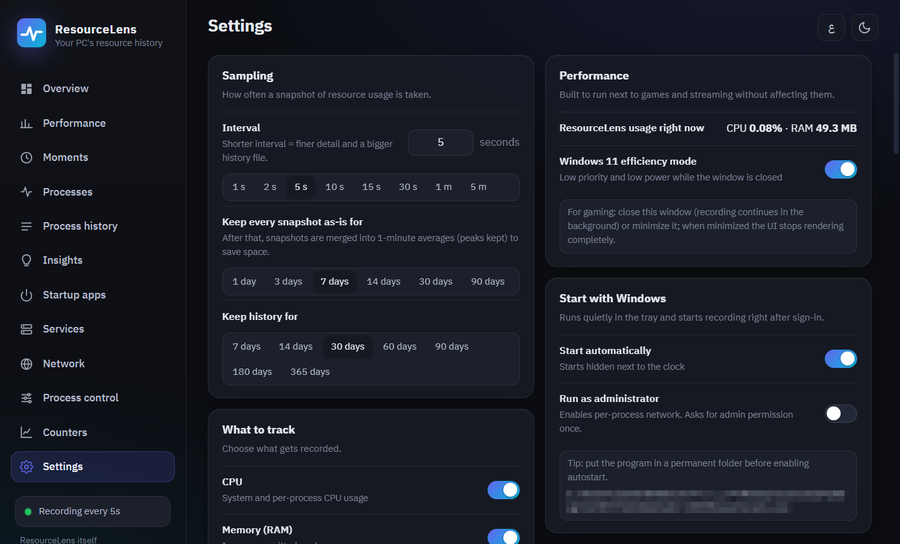

# ResourceLens

**A complete history of your PC's resource use since it was switched on: CPU, memory, disk, network, GPU and temperatures, for every app and every process inside it.**

[العربية](README.md) · [Download](https://github.com/AL-Bassam/ResourceLens/releases/latest) · [License: MIT](LICENSE)

## Why ResourceLens?

Task Manager only shows what is happening **right now**. If your PC slowed down an hour ago, memory filled up during a game, or temperatures spiked overnight, you will never know what caused it.

ResourceLens runs quietly next to the clock, takes a snapshot of the system every few seconds and keeps it. Later you can go back to any moment and see:
- exactly how much was used;
- which app was responsible, down to the process inside the app: which browser tab, which service inside `svchost`, which script `python` is running;
- what window you had in front of you at the time.

It is light enough to leave running next to games.

## Features

- **History since boot:** CPU, memory, disk, network, GPU, temperatures and clock speeds, for the whole system and for every app.
- **Moments:** every recorded snapshot with its real values, the active window, and the processes responsible at that exact moment.
- **Interactive charts:** drag to zoom into a period, click any point to open its details, and pick the time span: the whole period, 1 hour, 30 minutes and more.
- **Insights:** peak moments and their causes, memory-leak detection, and past alerts.
- **A Task Manager replacement:** a live performance page, end task and priority, plus startup apps and services.
- **Network monitor**, GlassWire-style: today's and this month's usage, live connections per app, an alert when an app connects for the first time, and one-click firewall blocking.
- **Process control**, Process Lasso-style:
  - permanent per-app rules: priority, CPU affinity, efficiency mode, and the power plan while gaming;
  - an optional ProBalance that keeps the app you are using responsive.
- **Performance counters**, Performance Monitor-style: any Windows counter on a live chart, with optional recording.
- **Gaming overlay:** a click-through corner panel with the values you pick, toggled with `Ctrl+Shift+O`.
- **Export for AI:** a self-describing JSON file you can give to ChatGPT, Claude or Gemini to analyse your PC's usage. CSV export is available too.
- **Arabic and English**, dark and light themes, and any page you don't need can be hidden.
- **Robust:**
  - the history file repairs itself if it is ever damaged, and keeps a copy of the damaged file;
  - the app restarts itself if recording gets stuck;
  - all data stays on your PC.

## Screenshots

| | |
|---|---|
|  |  |
| **Charts:** usage since boot; click any point to see what happened | **Moments:** every snapshot with the active window and the culprits |
|  |  |
| **Insights:** peak moments and the processes behind them | **Process history:** each app's average, peak and growth over the period |
|  |  |
| **Performance:** every core, memory, disks, network adapters, GPU | **Processes right now:** with end task and priority |
|  |  |
| **Network:** usage and live connections | **Process control:** rules and ProBalance |
|  |  |
| **Counters:** any Windows performance counter | **Settings:** interval, retention and what gets recorded |

 **The gaming overlay**

## Download and install

1. Download **`ResourceLens-Setup.exe`** (about 19 MB) from the [Releases page](https://github.com/AL-Bassam/ResourceLens/releases/latest).
2. Double-click it and press **Install**. It needs no administrator rights and no .NET install.
3. ResourceLens starts next to the clock, begins recording right away, and starts with Windows from then on.

> **Windows SmartScreen:** ResourceLens is free and not signed with a commercial certificate, so Windows may show "Windows protected your PC" the first time. Click **More info**, then **Run anyway**.
>
> To check that your file is the one published here, run `Get-FileHash .\ResourceLens-Setup.exe` in PowerShell and compare the result with the SHA-256 on the release page.

**Requirements:**
- 64-bit Windows 10 or 11.
- The Microsoft Edge WebView2 Runtime: built into Windows 11 and present on most Windows 10 PCs.

**Uninstall:** from *Installed apps* in Windows Settings, with the choice to keep or delete your history.

**Update:** run a newer setup file; your history and settings are kept.

The interface follows the setup language: Arabic on Arabic Windows, English otherwise. You can switch it at any time from the top bar. Windows' own process descriptions appear in your Windows display language.

## Privacy

- Everything ResourceLens records stays on your PC in `%LOCALAPPDATA%\ResourceLens` and is never sent anywhere.
- There is no telemetry and no usage tracking.
- Export files (JSON or CSV) are created only when you ask for them, and saved where you choose.
- Window titles are recorded so you can see what was in front of you; you can turn this off in Settings.

## FAQ

<b>Does it slow down my PC or games?</b>

No. In the background it uses about 0.03% of the CPU and under 50 MB of memory, runs at low priority and in Windows 11 efficiency mode. When its window is minimized, the interface stops rendering completely.

<b>Why does it suggest running as administrator?</b>

A few things need administrator rights:
- per-app network usage;
- blocking apps in the firewall;
- starting and stopping services;
- some sensors, such as fan speeds on Lenovo PCs.

Everything else works without it. You can enable *Run as administrator* in Settings; Windows asks for permission once.

<b>How much disk space does the history take?</b>

About 4 MB per thousand snapshots. At the default interval (one snapshot every 5 seconds) that is roughly 65 MB per full day of use during the full-resolution days. After that, snapshots are merged into one-minute averages and take far less space. You control the interval and retention in Settings.

<b>My antivirus flagged the file</b>

ResourceLens reads processes and can end them, and it controls services and the firewall. Some antivirus products treat those actions as suspicious, and the file is not code-signed, which makes a warning more likely. All of the code is here for anyone to review or build themselves.

<b>Are temperatures available on every PC?</b>

It depends on the hardware:
- **AMD CPUs and GPUs:** the most accurate readings, through the AMD Display Library.
- **All modern GPUs:** temperature through the Windows graphics interface.
- **Lenovo Legion devices:** fan speeds as well.
- **Intel CPUs:** approximate readings, through the system's ACPI thermal zones.

## Building from source

Requires the .NET 10 SDK. Double-click `build-setup.cmd`; it builds the app and the installer into `dist\ResourceLens-Setup.exe`. See [docs/DEVELOPMENT.md](docs/DEVELOPMENT.md) for details.

## License

[MIT](LICENSE): free to use, modify and distribute with attribution. Bundled libraries and their licenses are listed in [THIRD-PARTY-NOTICES.md](THIRD-PARTY-NOTICES.md).
