

# ResourceLens

Resource usage history for Windows: CPU, memory, disk, network, GPU and temperatures, per application and per process.

[Download](https://github.com/AL-Bassam/ResourceLens/releases/latest) · [العربية](README.md) · [MIT License](LICENSE)

Task Manager shows what is happening now. ResourceLens records a snapshot of the system every few seconds and keeps the history, so you can return to any point since the PC was started and see what was using the CPU, memory, disk, network or GPU at that time, and which window was in the foreground.

It runs in the notification area. While recording in the background it uses about 0.03% CPU and less than 50 MB of memory.

## Features

- Continuous recording of system-wide and per-application usage: CPU, memory, disk I/O, network, GPU, temperatures and clock speeds.
- Per-process detail within each application, such as individual browser processes, the services hosted by each `svchost.exe` and the script run by `python.exe`.
- A list of every recorded snapshot with its values, the foreground window and the processes responsible.
- Interactive charts with zoom and selectable time ranges.
- Insights: peak periods and their causes, steady memory growth (possible leaks) and alerts.
- Task Manager functions: a real-time Performance page with each GPU listed separately, end task, process priority, startup applications and services.
- Network monitor: data usage per day and per month, active connections per application, an alert when an application connects for the first time, and blocking through Windows Firewall.
- Process rules: priority, CPU affinity, efficiency mode and power plan per application, with optional automatic priority balancing.
- Performance counters: chart any Windows performance counter and optionally record it.
- An in-game overlay showing selected values, toggled with `Ctrl+Shift+O`.
- Export to CSV, or to a self-describing JSON file intended for analysis with an AI assistant.
- Arabic and English interface, light and dark themes.

## Screenshots

| | |
|---|---|
| 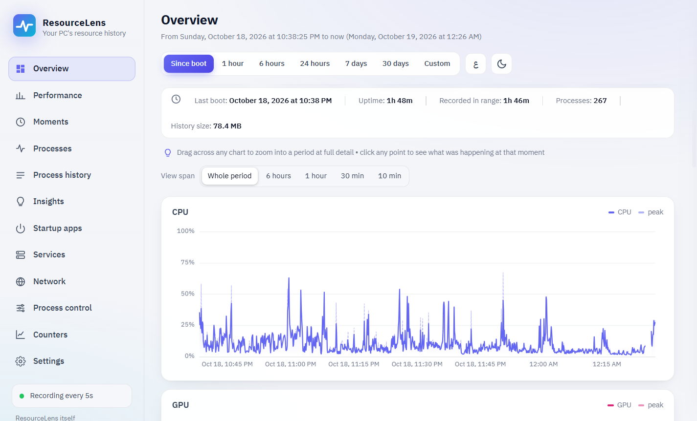 | 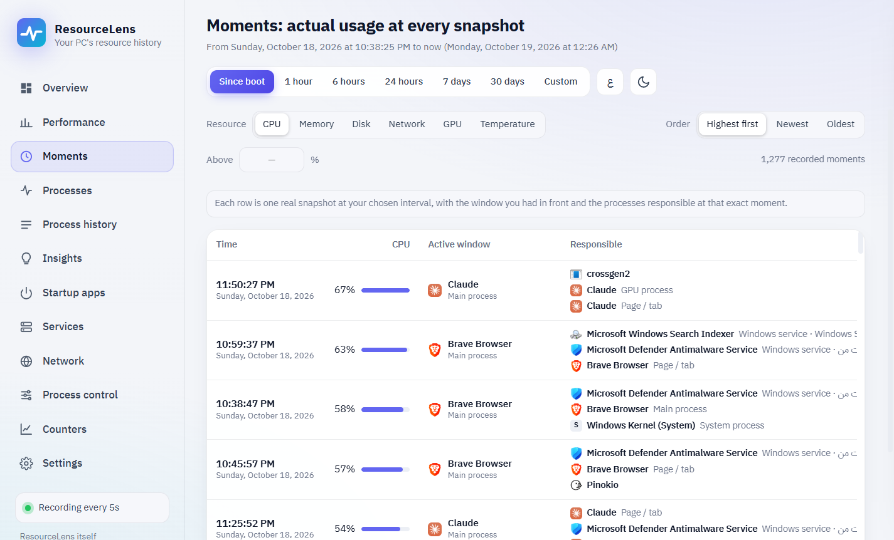 |
| Usage since boot. Selecting a point opens that moment. | Recorded snapshots with the foreground window and top processes. |
| 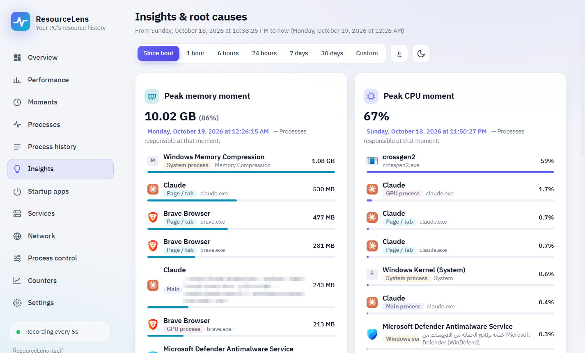 | 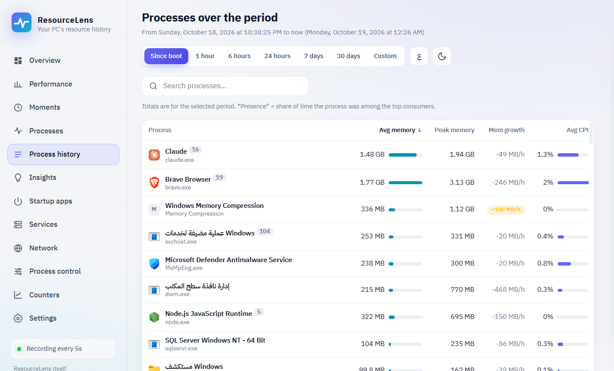 |
| Peak periods and the processes behind them. | Average, peak and growth of each application over a period. |
| 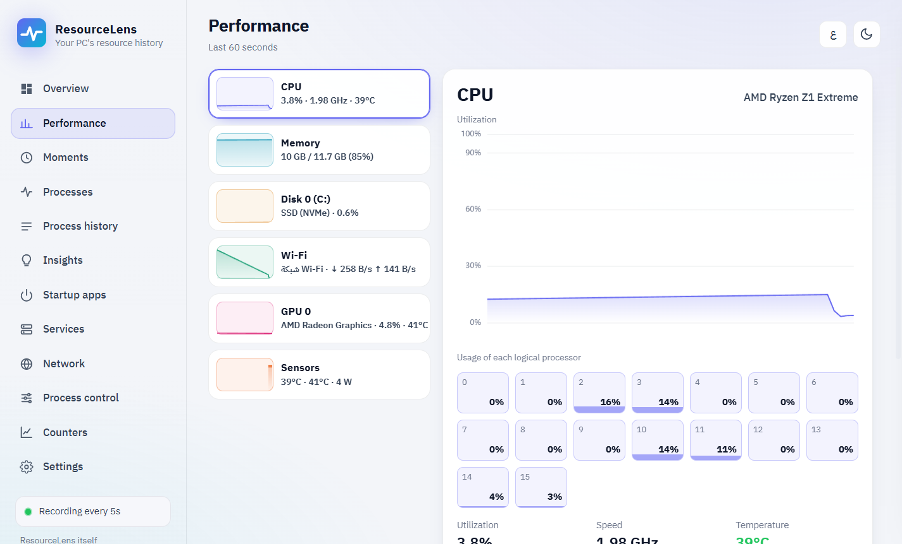 | 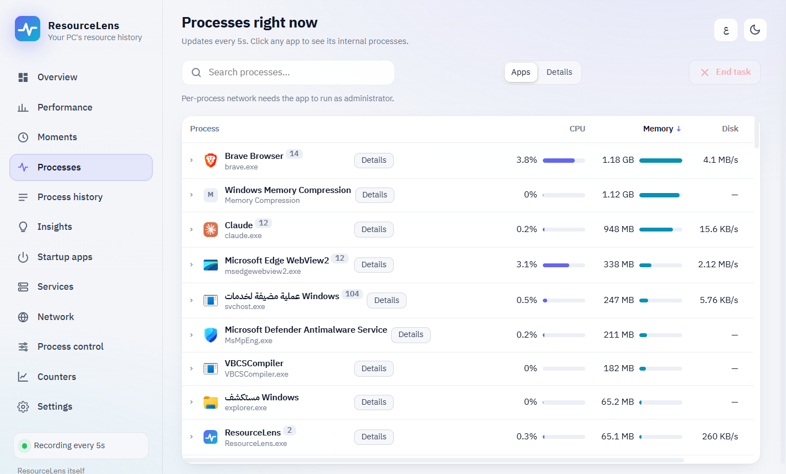 |
| CPU cores, memory, disks, network adapters and GPUs, updated every second. | Running processes, with end task and priority. |
| 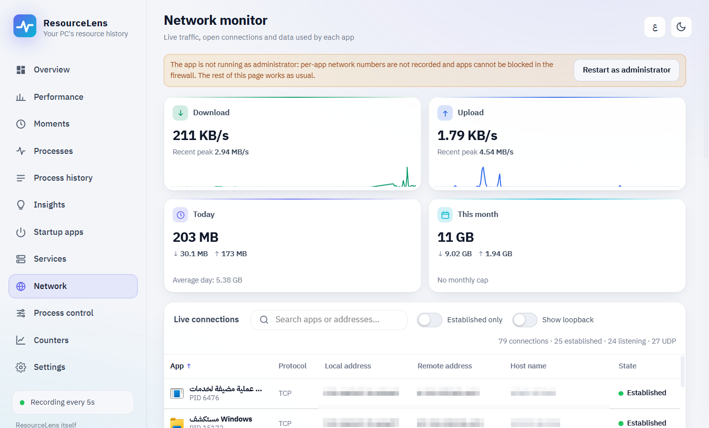 | 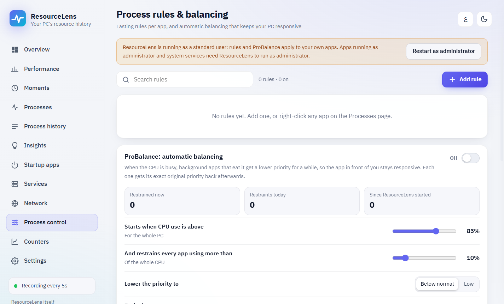 |
| Network usage and active connections. | Per-application rules and priority balancing. |
| 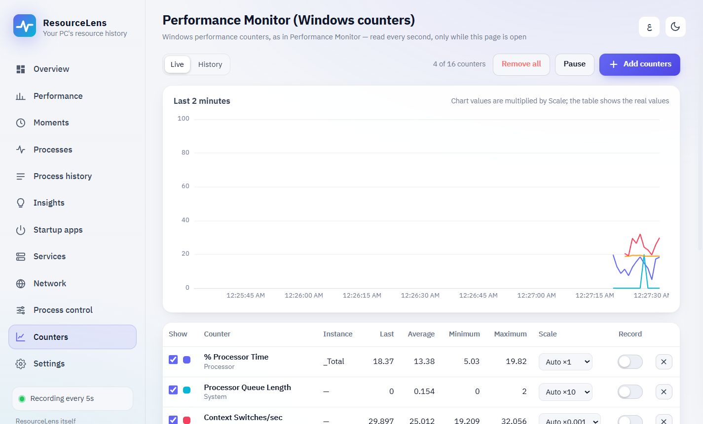 | 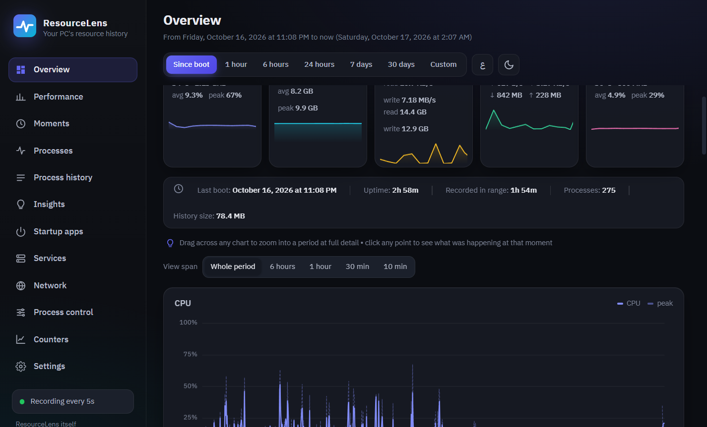 |
| Windows performance counters. | Dark theme. |

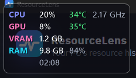

In-game overlay (`Ctrl+Shift+O`).

## Installation

1. Download `ResourceLens-Setup.exe` (about 19 MB) from the [latest release](https://github.com/AL-Bassam/ResourceLens/releases/latest).
2. Run it and select **Install**. Administrator rights and a separate .NET installation are not required.

ResourceLens starts in the notification area and, by default, starts with Windows. Running a newer setup file updates the installation and keeps the recorded history and settings. To uninstall, open **Settings › Apps › Installed apps**; you can choose whether to keep the history.

The setup file is not code-signed, so Windows SmartScreen may show a warning the first time it runs. Select **More info**, then **Run anyway**. Each release page lists the file's SHA-256 checksum, which you can compare with the output of `Get-FileHash .\ResourceLens-Setup.exe` in PowerShell.

## Requirements

- Windows 10 or Windows 11, 64-bit.
- Microsoft Edge WebView2 Runtime. It is included in Windows 11 and in up-to-date Windows 10 installations; if it is missing, the setup offers the download page.

ResourceLens is developed and tested on Windows 11. The following are not supported:

- macOS and Linux. ResourceLens is built on Windows-specific interfaces. On a Mac it runs only under Windows: Boot Camp on Intel-based Macs, or a Windows 11 virtual machine on Apple silicon (where hardware sensors are not available).
- 32-bit Windows, and Windows 10 on ARM. Windows 11 on ARM runs ResourceLens through x64 emulation; this has not been tested.
- Windows in S mode, and PCs where Smart App Control blocks applications that are not code-signed.

## Hardware support

Usage data (CPU, memory, disk, network, GPU utilization and everything per process) comes from standard Windows interfaces and works on any PC. Temperature, clock and fan readings depend on what the hardware and its drivers report:

| Hardware | Available readings |
|---|---|
| AMD Ryzen processors with integrated Radeon graphics | CPU, GPU and SoC temperature, clock speeds, power (AMD Display Library) |
| AMD Radeon graphics cards | GPU temperature, hotspot, clock speeds, power, fan speed |
| NVIDIA GeForce and other graphics cards | GPU temperature and clock speeds, as reported by the driver to Windows (the values Task Manager shows) |
| Laptops with integrated and discrete graphics | Each GPU is shown separately; the recorded GPU temperature is the discrete GPU's |
| Intel processors, and AMD processors without integrated Radeon graphics | CPU temperature only if the firmware provides ACPI thermal zones. This value is often approximate and many desktop PCs do not provide it |
| Lenovo Legion devices | CPU and GPU temperature and fan speeds from the embedded controller, when running as administrator |
| Virtual machines | Usage data only |

Reading the exact core temperature of every processor requires a kernel-mode driver. ResourceLens does not install one.

## Administrator rights

ResourceLens runs as a standard user. The following features need administrator rights, which can be enabled under **Settings › Run as administrator** (Windows asks once):

- per-application network usage;
- blocking applications in Windows Firewall;
- starting and stopping services;
- Lenovo fan and temperature sensors.

## Privacy

- All data is stored on the PC, in `%LOCALAPPDATA%\ResourceLens`. ResourceLens does not send data anywhere and contains no telemetry.
- The title of the foreground window is recorded. This can be turned off in Settings.
- Process command lines are stored to identify processes. Values that look like passwords or access tokens are masked.
- Export files are created only on request and saved where you choose.

## Disk space

The history uses about 4 MB per 1,000 snapshots. At the default interval of 5 seconds, that is about 65 MB per day of use. After the full-resolution period, snapshots are merged into one-minute averages, which take much less space. The interval, the full-resolution period and the retention period can be changed in Settings.

## Building from source

Install the [.NET 10 SDK](https://dotnet.microsoft.com/download) and run `build-setup.cmd`. It builds the application and the installer into `dist\ResourceLens-Setup.exe`. See [docs/DEVELOPMENT.md](docs/DEVELOPMENT.md) for the project layout and test options.

## Feedback

Bug reports and suggestions are welcome in [Issues](https://github.com/AL-Bassam/ResourceLens/issues).

## License

[MIT](LICENSE). Third-party components and their licenses are listed in [THIRD-PARTY-NOTICES.md](THIRD-PARTY-NOTICES.md).
