

# ResourceLens — عدسة الموارد

**سجلّ كامل لاستهلاك جهازك منذ لحظة تشغيله: المعالج والذاكرة والقرص والشبكة وكرت الشاشة والحرارة، لكل برنامج ولكل عملية بداخله.**

[English](README.en.md) · [تنزيل البرنامج](https://github.com/AL-Bassam/ResourceLens/releases/latest) · [الترخيص: MIT](LICENSE)

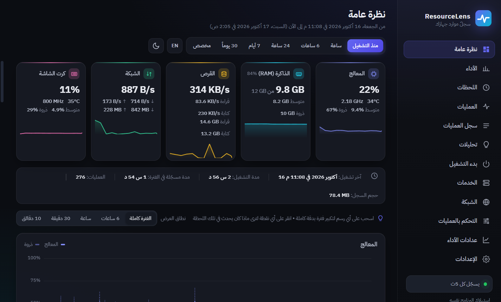

## لماذا ResourceLens؟

مدير المهام في ويندوز يعرض ما يحدث **الآن** فقط. فإذا تباطأ جهازك قبل ساعة، أو امتلأت الذاكرة أثناء اللعب، أو ارتفعت الحرارة ليلاً، فلن تعرف أبداً ما الذي تسبّب في ذلك.

ResourceLens يعمل بهدوء بجانب الساعة، ويأخذ لقطة من الجهاز كل بضع ثوانٍ ويحفظها. بعدها تستطيع الرجوع إلى أي لحظة لترى:
- كم كان الاستهلاك بالضبط؛
- أي برنامج تسبّب فيه، بل أي عملية داخل البرنامج: أي تبويب في المتصفح، وأي خدمة داخل `svchost`، وأي سكربت يشغّله `python`؛
- وما النافذة التي كانت أمامك وقتها.

وهو خفيف جداً، فيعمل بجانب الألعاب دون أن تشعر به.

## المزايا

- **سجلّ منذ التشغيل:** المعالج والذاكرة والقرص والشبكة وكرت الشاشة والحرارة والسرعات، لكل النظام ولكل تطبيق.
- **اللحظات:** كل عينة مسجّلة بقيمتها الفعلية، مع النافذة النشطة والعمليات المسؤولة عن الاستهلاك في تلك اللحظة.
- **رسوم تفاعلية:** اسحب على أي رسم لتكبير فترة، وانقر على أي نقطة لتفتح تفاصيلها، واختر نطاق العرض: الفترة كاملة أو ساعة أو 30 دقيقة.
- **تحليلات:** لحظات الذروة وأسبابها، وكشف تسرّب الذاكرة، والتنبيهات السابقة.
- **بديل لمدير المهام:** صفحة أداء تتحدّث كل ثانية، وإنهاء المهام وتغيير الأولوية، وإدارة برامج بدء التشغيل والخدمات.
- **مراقبة الشبكة** على طريقة GlassWire: استهلاك اليوم والشهر، والاتصالات الحية لكل تطبيق، وتنبيه عند أول اتصال لتطبيق جديد، وحظر أي تطبيق بجدار الحماية.
- **التحكم بالعمليات** على طريقة Process Lasso:
  - قواعد دائمة لكل برنامج: الأولوية، والأنوية، ووضع الكفاءة، وخطة الطاقة أثناء اللعب.
  - توازن تلقائي اختياري يحافظ على سرعة استجابة البرنامج الذي تستخدمه.
- **عدادات الأداء** على طريقة Performance Monitor: أي عداد من عدادات ويندوز في رسم حي، مع خيار تسجيله.
- **شاشة عائمة أثناء اللعب:** لوحة شفافة في زاوية الشاشة تعرض ما تختاره، وتُظهَر وتُخفى بـ `Ctrl+Shift+O`.
- **تصدير للذكاء الاصطناعي:** ملف JSON يشرح نفسه، تعطيه لـ ChatGPT أو Claude أو Gemini ليحلّل استهلاك جهازك. ويمكن التصدير بصيغة CSV أيضاً.
- **عربي وإنجليزي**، بوضع داكن وفاتح، مع إمكانية إخفاء أي صفحة لا تحتاجها.
- **موثوق:**
  - يُصلح ملف السجل نفسه إذا تلف، ويحتفظ بنسخة من الملف التالف.
  - يعيد تشغيل نفسه إذا علِق التسجيل.
  - كل البيانات تبقى على جهازك.

## الصور

| | |
|---|---|
| 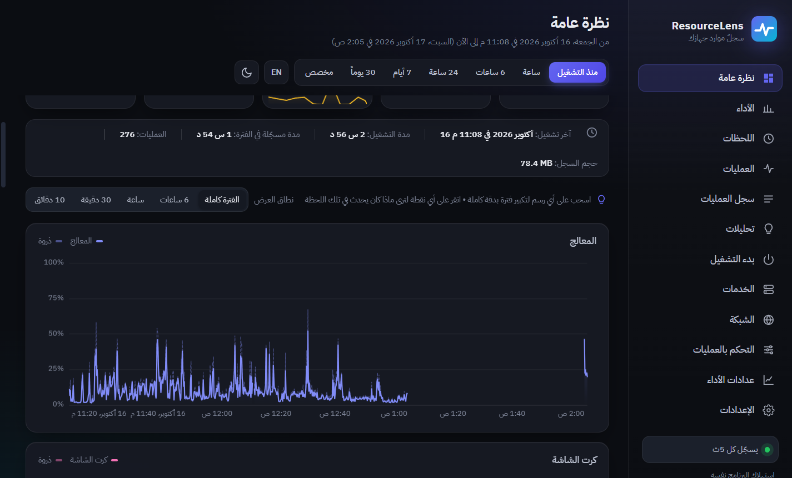 | 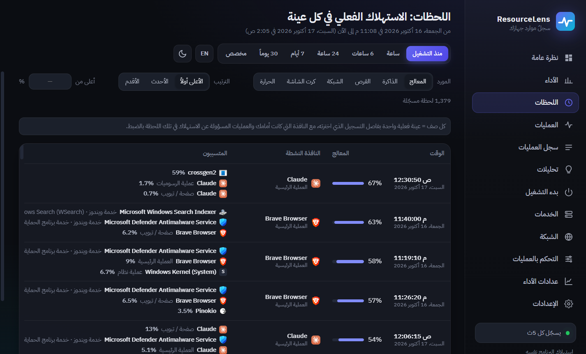 |
| **الرسوم:** الاستهلاك منذ التشغيل، وانقر أي نقطة لترى ما حدث وقتها | **اللحظات:** كل عينة مع النافذة النشطة والمتسببين |
| 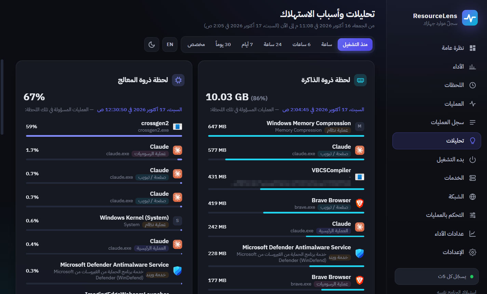 | 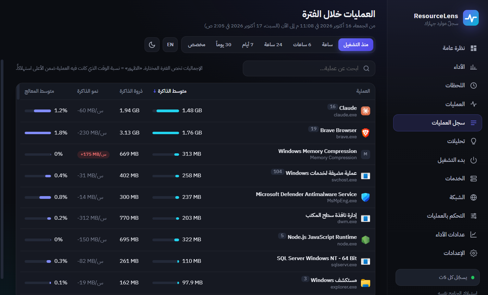 |
| **التحليلات:** لحظات الذروة والعمليات المسؤولة عنها | **سجل العمليات:** متوسط كل برنامج وذروته ونموّه خلال الفترة |
| 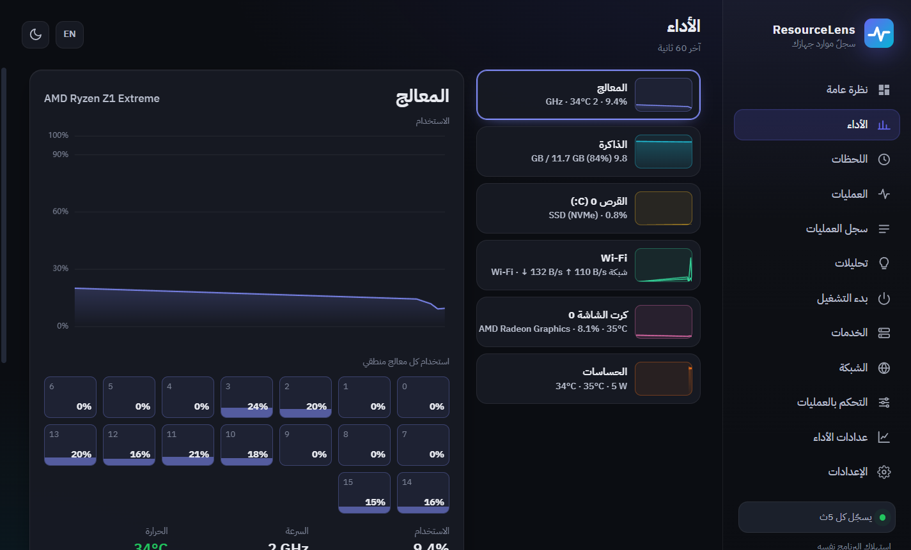 | 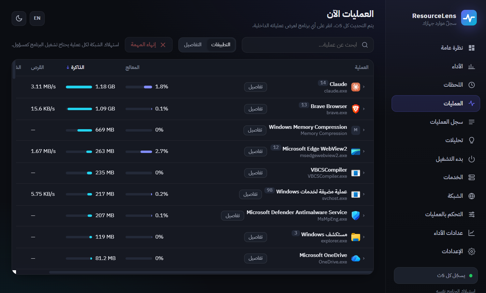 |
| **الأداء:** كل نواة، والذاكرة، والأقراص، والشبكة، وكرت الشاشة | **العمليات الآن:** مع إنهاء المهمة وتغيير الأولوية |
| 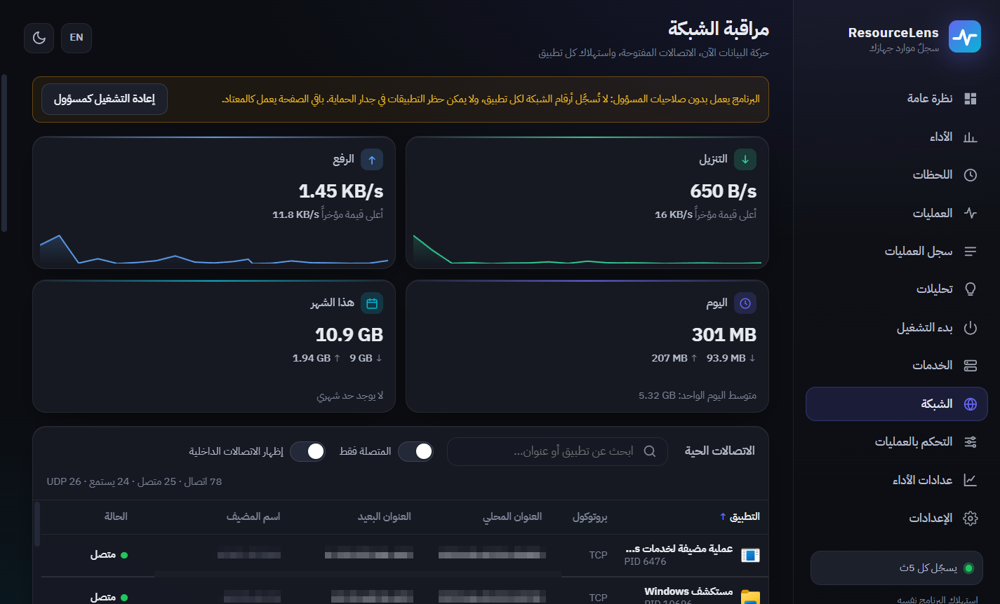 | 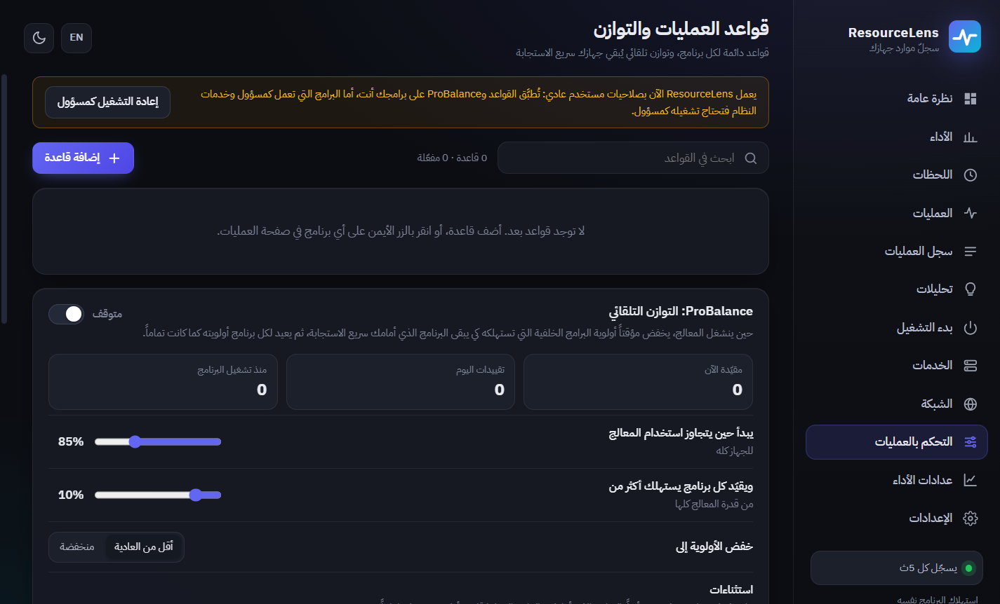 |
| **الشبكة:** الاستهلاك والاتصالات الحية | **التحكم بالعمليات:** القواعد والتوازن التلقائي |
| 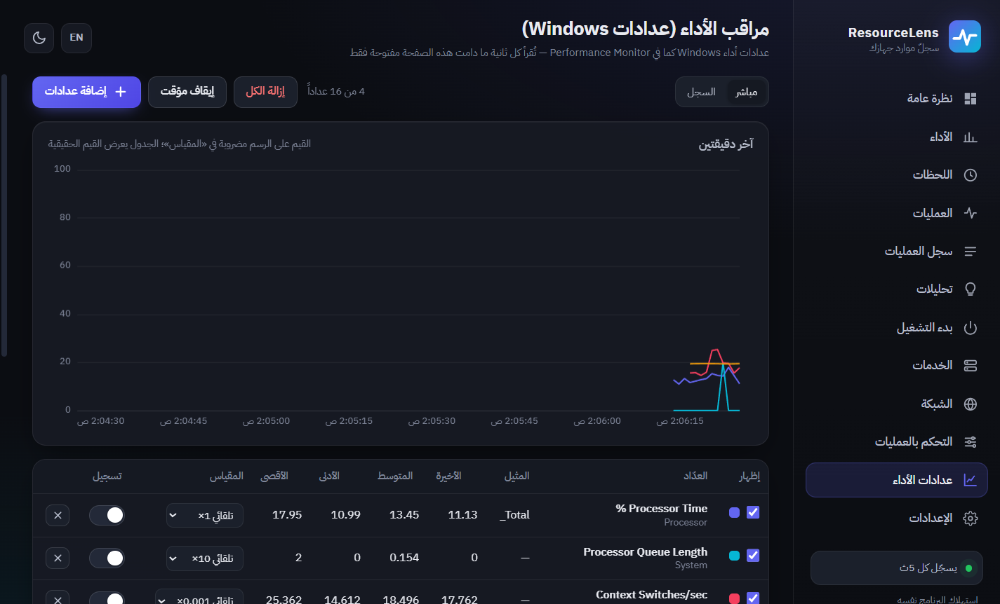 | 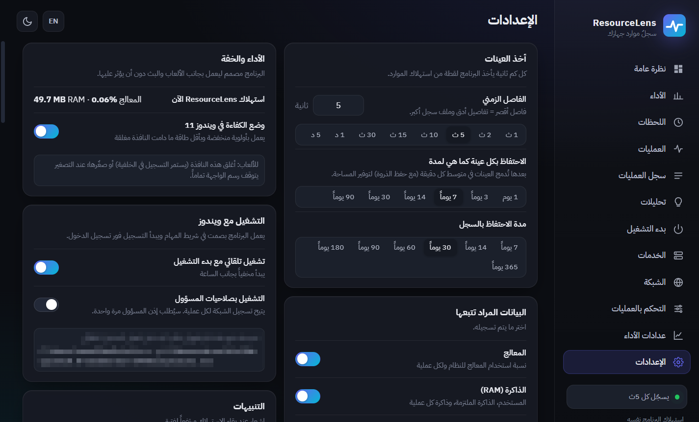 |
| **عدادات الأداء:** أي عداد من عدادات ويندوز | **الإعدادات:** الفاصل الزمني، ومدة الاحتفاظ، وما يُسجَّل |

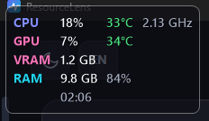 **الشاشة العائمة أثناء اللعب**

## التنزيل والتثبيت

1. نزّل **`ResourceLens-Setup.exe`** (نحو 19 MB) من [صفحة الإصدارات](https://github.com/AL-Bassam/ResourceLens/releases/latest).
2. شغّله بالنقر المزدوج، ثم اضغط «تثبيت». لا يحتاج صلاحيات المسؤول ولا تثبيت .NET.
3. يعمل البرنامج بجانب الساعة ويبدأ التسجيل فوراً، ويبدأ تلقائياً مع ويندوز في كل مرة.

> **تحذير ويندوز (SmartScreen):** البرنامج مجاني وغير موقّع بشهادة تجارية، لذلك قد يظهر «Windows protected your PC» عند تشغيله أول مرة. اضغط **«مزيد من المعلومات»** ثم **«التشغيل على أي حال»**.
>
> للتأكد من أن الملف هو نفسه المنشور هنا، احسب بصمته بالأمر `Get-FileHash .\ResourceLens-Setup.exe` في PowerShell، وقارنها بالبصمة المكتوبة في صفحة الإصدار.

**المتطلبات:**
- ويندوز 10 أو 11 بإصدار 64 بت.
- مكوّن Microsoft Edge WebView2: موجود في ويندوز 11، وفي أغلب أجهزة ويندوز 10.

**الإزالة:** من «التطبيقات المثبتة» في إعدادات ويندوز، مع خيار حذف السجل أو الإبقاء عليه.

**التحديث:** شغّل ملف التثبيت الأحدث، وسيُحدَّث البرنامج مع الإبقاء على سجلك وإعداداتك.

## الخصوصية

- كل ما يسجّله البرنامج يبقى على جهازك في `%LOCALAPPDATA%\ResourceLens`، ولا يُرسَل إلى أي مكان.
- لا يحتوي البرنامج على أي تتبّع أو إحصاءات استخدام.
- ملفات التصدير (JSON أو CSV) تُنشأ فقط عندما تطلبها أنت، وتُحفظ حيث تختار.
- عناوين النوافذ تُسجَّل لتعرف ماذا كان أمامك، ويمكنك إيقاف ذلك من الإعدادات.

## أسئلة شائعة

<b>هل يبطّئ الجهاز أو الألعاب؟</b>

لا. في الخلفية يستهلك نحو 0.03% من المعالج وأقل من 50 MB من الذاكرة، ويعمل بأولوية منخفضة وفي «وضع الكفاءة» في ويندوز 11. وعند تصغير نافذته تتوقف واجهته عن الرسم تماماً.

<b>لماذا يقترح التشغيل كمسؤول؟</b>

بعض الأشياء تحتاج صلاحيات المسؤول:
- استهلاك الشبكة لكل تطبيق؛
- حظر التطبيقات بجدار الحماية؛
- تشغيل الخدمات وإيقافها؛
- قراءة بعض الحساسات، مثل مراوح أجهزة Lenovo.

كل ما عدا ذلك يعمل بصلاحيات عادية. يمكنك تفعيل «التشغيل بصلاحيات المسؤول» من الإعدادات، فيطلب ويندوز الإذن مرة واحدة فقط.

<b>كم يأخذ السجل من القرص؟</b>

نحو 4 MB لكل ألف عينة. عند الفاصل الافتراضي (عينة كل 5 ثوانٍ) يعني ذلك نحو 65 MB لكل يوم كامل من التشغيل خلال أيام الدقة الكاملة. بعد ذلك تُدمج العينات في متوسطات بالدقيقة فيصغر حجمها كثيراً. تتحكم في الفاصل ومدة الاحتفاظ من الإعدادات.

<b>برنامج الحماية حذّر من الملف</b>

البرنامج يقرأ العمليات ويستطيع إنهاءها، ويتحكم في الخدمات وجدار الحماية، وهذه أفعال قد تثير ريبة بعض برامج الحماية. والملف غير موقّع رقمياً، وهذا يزيد الاحتمال. الكود كله مفتوح هنا لمن يريد مراجعته أو بناء البرنامج بنفسه.

<b>هل تُقرأ الحرارة على كل الأجهزة؟</b>

يعتمد ذلك على العتاد:
- **كروت AMD ومعالجاتها:** القراءة أدق، عبر مكتبة AMD.
- **كل كروت الشاشة الحديثة:** حرارتها تُقرأ عبر واجهة ويندوز للرسوميات.
- **أجهزة Lenovo Legion:** تُقرأ مراوحها أيضاً.
- **معالجات Intel:** القراءة تقريبية، عبر المناطق الحرارية للنظام.

## البناء من الكود

يتطلب .NET SDK 10. انقر مرتين على `build-setup.cmd`، فيُبنى البرنامج وملف التثبيت في `dist\ResourceLens-Setup.exe`. التفاصيل في [docs/DEVELOPMENT.md](docs/DEVELOPMENT.md).

## الترخيص

[MIT](LICENSE): مجاني للاستخدام والتعديل والتوزيع مع ذكر المصدر. أما المكتبات المضمّنة وتراخيصها ففي [THIRD-PARTY-NOTICES.md](THIRD-PARTY-NOTICES.md).
